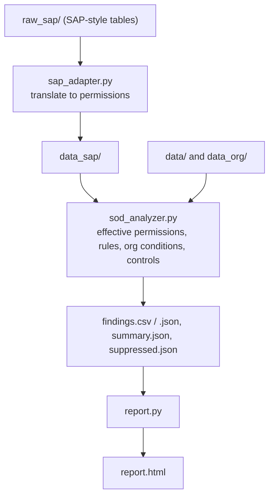

# SoD Analyzer: SAP-style Segregation of Duties analysis

A Python tool that detects toxic permission combinations (segregation of duties
conflicts) from role and permission data, explains each finding with evidence, and
produces reports for GRC review. Built on **synthetic data** as a learning and
demonstration project. Pure Python standard library, no dependencies.

 

## The business problem
If one employee can both create a supplier and execute payments, fraud becomes
possible without collusion. Access reviews look for exactly these combinations.

## What it does
- Computes each user's **effective permissions** across all assigned roles
- Evaluates them against a **configurable ruleset** (5 sample rules, SOD-01 to SOD-05)
- Records **evidence**: which role granted which permission
- Supports **compensating controls**: a valid exception downgrades severity, an
  expired one reverts and is flagged
- Supports **organizational conditions**: a conflict counts only if the permissions
  overlap in the same company code
- Translates **SAP-style tables** (AGR_USERS, AGR_TCODES, AGR_1251) into the model,
  honoring activity values, company codes and role validity dates
- Produces CSV, JSON, a summary, and a one-page **HTML report**

## How it works


## Quick start
Requires Python 3.8+. No installation needed.
```
python sod_analyzer.py                          # basic demo + exceptions
python report.py output                         # HTML report for that run
python sap_adapter.py                           # convert the synthetic SAP export
python sod_analyzer.py data_sap output_sap      # analyze converted data
python report.py output_sap
python sod_analyzer.py data_org output_org      # company-code conditions demo
python -m unittest -v                           # 17 tests
```
Sample outputs are in `examples/`.

> Note: the demo exception for U1002 expires on its date in `data/exceptions.csv`.
> After that date its status changes from Mitigated to Exception expired.

## Project structure
| Path | Role |
|---|---|
| `sod_analyzer.py` | Analysis engine |
| `sap_adapter.py` | Converts SAP-style tables into the engine's model |
| `report.py` | Generates the HTML report |
| `test_sod_analyzer.py` | 17 unit tests |
| `data/`, `data_org/` | Demo inputs (basic + organizational conditions) |
| `raw_sap/` | Synthetic SAP-style export (adapter input) |
| `examples/` | Saved sample outputs |

## Design decisions
- Rules are data (CSV), not code, so a GRC team can review and change them
- Every finding is explainable: conflicting permissions plus the roles that grant them
- Suppressed findings are listed, never silently dropped
- A control can lower severity but never raise it
- A permission with no organizational restriction is treated as "all units",
  which errs toward flagging

## Limitations
- Permission names and rules are simplified illustrations, not a validated ruleset
- Risk-score weights are illustrative; a real client's risk policy defines them
- The SAP adapter works on synthetic data. It does not handle the AUTH column,
  composite or derived roles, or locked users. Value ranges are treated as "all"
- No transaction-level analysis and no testing of control effectiveness
- Not a substitute for SAP GRC Access Control. It is a transparent engine for
  learning and demonstrating the method

## Roadmap
Composite-role expansion, the AUTH column, ruleset validation, adapter tests.

## Ethics
Synthetic data only. Any real use requires written authorization and read-only
access, and user IDs should be pseudonymized in any shared output.

## License
MIT